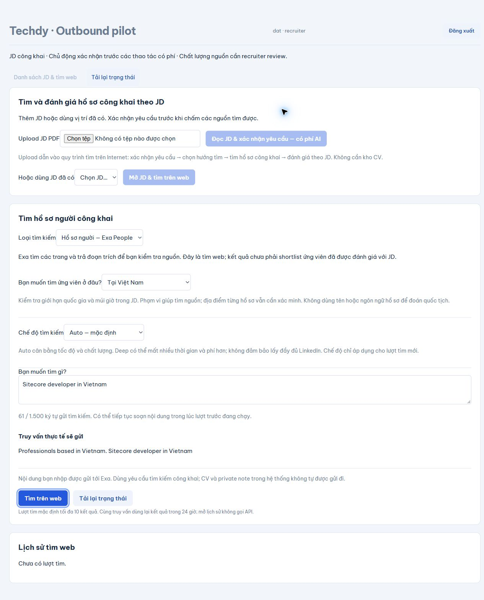

# Techdy — recruiter-controlled outbound pilot

A recruitment workflow built around recruiter review, explicit paid-action confirmation, and traceable inputs. Built with React/TypeScript, FastAPI, and PostgreSQL; deployed as a private two-user pilot on Botkeep.

*Real deployed interface, not a mockup. The query is an example; no paid search was submitted for this screenshot. The fresh workspace has no search results.*

## Workflow

Public JD → recruiter approves requirements → edits business guidance → reviews search strategies and the final Exa query → explicitly confirms search → reviews sources → exports profile links → submits feedback.

## Engineering focus

- Separate admin and recruiter access, database-backed sessions, CSRF protection, and protected exports.
- Explicit confirmation before paid JD processing or Exa searches.
- Versioned guidance and configuration, persisted run history, and trace/artifact inspection.
- FastAPI serves the built frontend with one application process; PostgreSQL connections verify TLS certificates.
- Independent database/upload backups and an isolated restore check.

## Verified scope — 15 October 2026

Deployment handover recorded 32 passing related automated tests and a successful frontend build. Three mocked workflow fixtures covered Sitecore, Deputy General Director, and Senior Accountant. Live checks covered login/roles, CSRF, anonymous access restrictions, restart persistence, and local backup restoration.

**Limits:** paid AI/Exa end-to-end runs were not executed during deployment acceptance. Search relevance and shortlist quality require recruiter review; fixture results are not provider results or hiring-accuracy benchmarks. This is a two-person pilot, not a multi-tenant production service. The deployed release uses a newer working-tree build than the source currently published in this repository.

Botkeep's supplied database owner login is temporarily shared by migrations and runtime; restricted application roles and a private-only database endpoint are not available in the current panel. No customer CV pool, private notes, credentials, or localhost history are included here.
